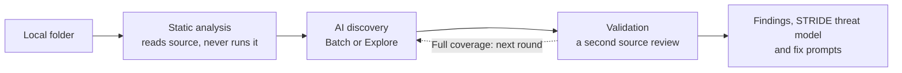

<p align="center">
  
</p>

<h1 align="center">Plenger</h1>

<p align="center">
  <strong>Security review that runs locally.</strong><br>
  <em>Please Let Every Null Get Escaped, Right?</em>
</p>

<p align="center">
  <a href="https://www.npmjs.com/package/plenger"></a>
  
  
  
</p>

<p align="center">
  <a href="docs/guide/install.md">Install</a> ·
  <a href="docs/guide/dashboard.md">Dashboard</a> ·
  <a href="docs/STATUS.md">Status</a> ·
  <a href="docs/RULES.md">Rules</a> ·
  <a href="CHANGELOG.md">Changelog</a>
</p>

---

Plenger reads your code like a careful reviewer. It traces the risk, checks the
claim and cites the line. One npm package starts a local dashboard. You add a
project folder, pick a model and start a scan. Static analysis, AI discovery,
a second validation pass and a STRIDE threat model all run from your machine.

It is modeled on Codex Security Cloud, without the cloud. Its specialty is
agentic AI code in Python, JavaScript and TypeScript. Every other language
still gets an AI review as text.

## Highlights

| | |
| --- | --- |
| **Static analysis that never runs your code** | Parses source, traces model and request input to commands, files, SQL, URLs and deserializers, then names one of 41 default rules. No install, no import, no network. |
| **AI review with a skeptic built in** | Each round discovers candidates, then a second source review confirms or dismisses them with cited lines the host checks. Candidates it cannot finish stay Unvalidated, never silently dropped. |
| **Coverage you can see** | Quick reviews one round. Full coverage keeps going until the source is read or an optional token or USD limit is reached. The scan page shows each round, the files covered and the tokens used while it runs. |
| **A threat model that stays** | All six STRIDE categories, assets and trust boundaries are saved per project, and every later review starts from them. |
| **Findings you can act on** | Severity by reach, CWE ids, source excerpts, five triage states that survive rescans, and a fix prompt you can hand to a coding agent. |
| **Your model, your bill** | OpenAI, Anthropic Claude, Gemini, Ollama or a ChatGPT subscription. Cost estimates use model prices captured when a scan starts. |

## How a scan works



1. **Read.** The static engine reads every file, builds an inventory of agents,
   tools and entry points, and traces paths from untrusted input to effects.
2. **Discover.** The model reviews the source in rounds. In Explore mode it
   reads the allowed files itself through four read-only tools.
3. **Validate.** A second review reads the cited files with their imports and
   callers. It supports, dismisses with a checked basis, or asks for review.
4. **Keep.** Findings, the threat model and the full activity are saved
   locally. A scan can be paused, stopped and continued.

## Quick start

Plenger needs Node.js 22.23.4+, 24.22.1+ or 26.12.1+. Earlier patches carry the
Brotli flaw CVE-2026-111497 (Node2Shell).

Run it with npx, or install it globally:

```sh
npx plenger@latest
```

```sh
npm install -g plenger
plenger
```

Plenger is a preview: see [status](docs/STATUS.md) for what is qualified. To run it
from source instead, use pnpm 10.19.0:

```sh
git clone https://github.com/ajipurn/plenger.git
cd plenger
pnpm install --ignore-scripts
pnpm dashboard:build
pnpm dev --workspace path/to/project
```

Open the printed local URL. Save a connection under **Settings > Providers**,
add your project and press **New Scan**. Stop the dashboard with Ctrl+C.

## Private by design

- **Source stays local.** Files leave the machine only for the provider you
  select, after secrets are redacted.
- **Keys are sealed.** Provider keys are encrypted at rest in a local SQLite
  database and never written to reports or logs.
- **Nothing runs on its own.** Every scan starts by hand. There are no
  monitors, hosted scans or remote repository connections.
- **Project code never executes.** Static analysis and AI review only read
  files.

## Static rules and risk mappings

The [rule catalog](docs/RULES.md) defines 48 static risk rules. A default scan
uses 41 of them. Seven library rules (`PLG901` to `PLG907`) need
`library: true` in the engine API and are not exposed in the dashboard.

| Reference | Catalog mappings | Scope |
| --- | --- | --- |
| [OWASP Top 10 for LLM Applications 2025](https://genai.owasp.org/llm-top-10/) | 8 of 10 categories | No mapping for LLM04 Data and Model Poisoning or LLM09 Misinformation |
| [OWASP Top 10 for Agentic Applications 2026](https://genai.owasp.org/resource/owasp-top-10-for-agentic-applications-for-2026/) | 9 of 10 categories | ASI01 to ASI09 have mappings; ASI10 has none |
| [Common Weakness Enumeration](https://cwe.mitre.org/about/index.html) | 27 distinct CWE IDs | Selected weaknesses, including path traversal, command injection, SQL injection, unsafe deserialization and SSRF |

A mapping means at least one rule addresses a specific pattern in that
category. It does not establish full detection coverage for the category. For
example, `PLG101` finds a tool that runs a shell command built from model
input and maps it to `LLM06:2025` Excessive Agency, with no model call.
[Static analysis](docs/guide/scanning.md) explains the tracing limits.

## Evidence

Numbers come from dated qualification records, not from marketing.

| What was measured | Result | Record |
| --- | --- | --- |
| Static rules on 150 labeled cases | Precision 1.00, recall 0.91 | [2026-10-21](docs/qualifications/detection-static-2026-10-21-recall.md) |
| AI review, Batch, ChatGPT `gpt-6.1-sol`, 150 cases | Precision 0.87, recall 0.87; 0.88 and 0.95 with static findings kept | [2026-10-30](docs/qualifications/review-chatgpt-batch-2026-10-30.md) |
| AI review, Explore, Claude Haiku 5.5, 150 cases, three runs | Precision 0.68, recall 1.00 | [2026-10-21](docs/qualifications/detection-claude-haiku-2026-10-21-full-corpus.md) |
| Full coverage scan of Vercel ai-chatbot | 131 of 166 files in 25 reviews for USD 4.65 | [2026-10-21](docs/qualifications/full-coverage-ai-chatbot-2026-10-21.md) |

Every record used bundled fixtures, the evaluation corpus or a few named
projects. None establishes support for arbitrary projects, provider billing
caps or protection against malicious project code. [Status](docs/STATUS.md)
lists what is qualified and what is pending.

## Command line

```sh
plenger                                    # start the dashboard
plenger --workspace path/to/project --port 4180
plenger --data-dir path/to/data            # keep data somewhere else
plenger update                             # update a global npm install after confirming
plenger --help
plenger --version
```

Published builds check for a newer stable release at most once a day and never
block the dashboard. Set `NO_UPDATE_NOTIFIER=1` to turn the check off. Updates
never install on their own, and they never move or delete dashboard data. See
[installation and updates](docs/guide/install.md).

## Reports and CI

The dashboard exports each scan as JSON. The composite
[GitHub Action](action.yml) runs the static engine in your workflow and writes
SARIF, a Markdown job summary and a severity gate, with explicit baseline and
suppression files. An opt-in AI review of the scanned path sends redacted source
to the chosen provider and adds its findings as a second SARIF run. See
[reports and CI](docs/guide/reports-ci.md).

## Documentation

| Read | When you want to |
| --- | --- |
| [Dashboard](docs/guide/dashboard.md) | Add projects, run scans, triage findings and set up providers |
| [AI security review](docs/guide/ai-security-review.md) | Understand discovery, validation, STRIDE and coverage |
| [Static analysis](docs/guide/scanning.md) | See what the engine reads, traces and reports |
| [Status and qualifications](docs/STATUS.md) | Check what is available, qualified and pending |
| [Architecture](docs/ARCHITECTURE.md) and [roadmap](docs/ROADMAP.md) | Follow the source layout and where Plenger is going |
| [Documentation index](docs/README.md) | Find everything else |

## Development

[CONTRIBUTING.md](CONTRIBUTING.md) covers the toolchain, checks, fixtures and
benchmarks. [AGENTS.md](AGENTS.md) holds instructions for coding agents. Report
security issues as described in [SECURITY.md](SECURITY.md).

## License

Plenger is licensed under the [Apache License 2.0](LICENSE). Copyright 2026
Aji Purnomo. Third-party notices are listed in
[docs/licenses/sources.json](docs/licenses/sources.json) and shipped as
`dist/THIRD_PARTY_NOTICES.txt`.
